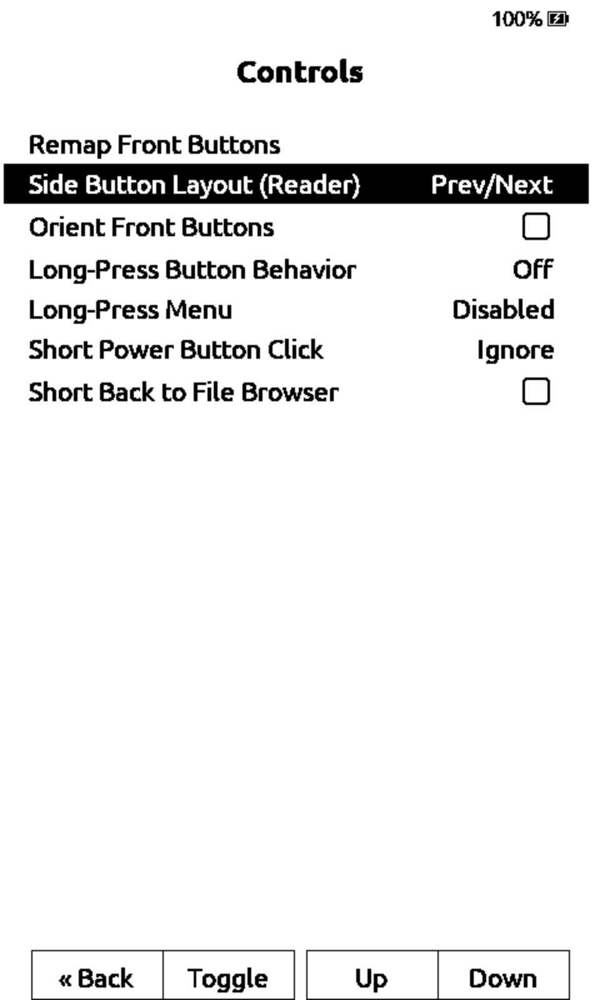
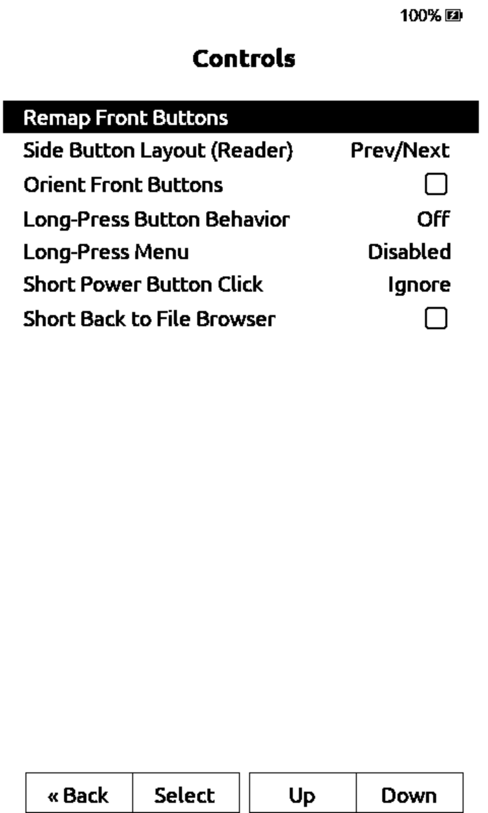
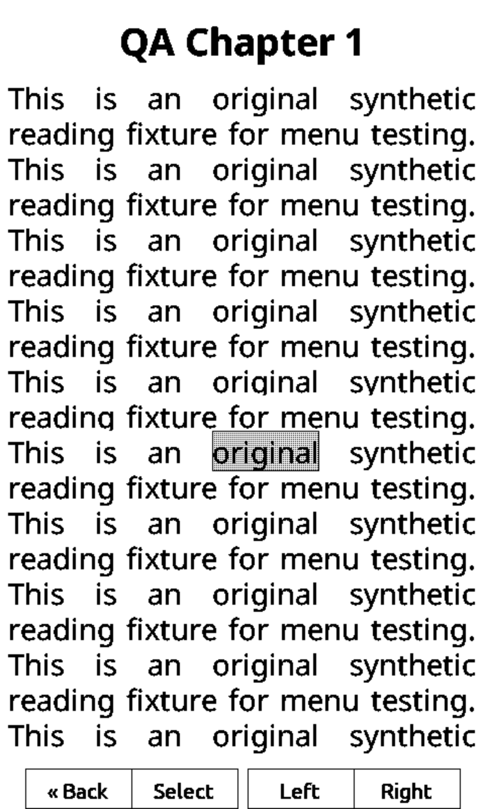

# Remapping and clipping QA

Native simulator screenshots, X4 layout, not device photos. All book text is an
original synthetic fixture. Physical X4 verification was separately confirmed by
the human on 2026-10-30; no photos were supplied.

## Remapping

Same input sequence and 5600 ms capture. After opening Remap Front Buttons, hold
side Down for one second and release. Before: the Settings cursor has moved to
Side Button Layout. After: it stays on Remap Front Buttons.

| Before | After |
| --- | --- |
|  |  |

## Clipping

The original long-move reproduction logs four "page buffer slots full" errors.
The fixed run logs zero. The 8700 ms and 11800 ms captures have identical pixels
before/after; clipping-selection.png is the fixed 11800 ms capture. No speedup,
physical heap measurement or crash fix is claimed.

## Source and validation

- Upstream develop: ad53eb645f27b76c8c4594fafe58479932234bf2.
- Baseline captures: that base plus font-browser changes at 697a2d166747281fc97913dca1f3afd528346493;
  those changes do not touch remapping or clipping.
- Fixed captures: upstream base plus the independently reviewed remapping and
  clipping changes, subsequently committed as 60f74c740 and 13a178ea1.
- SDK: 946e6ac3d7a9d590ba3224428e6183d55ac7917c.
- 12 remapping simulator cases: held cancel/reset/final assignment in four forced orientations.
- Six clipping simulator cases: two reproductions, portrait/inverted and Alef SD font.
- Focused production-method host regressions and normal standalone X3/X4 builds passed.
- The fixed normal combined X4 binary was checked by the human. Its SHA256 is
  c15839d8c8ea4feeee001560ae17461414ec530d106ec9045eef9b763192728c.
