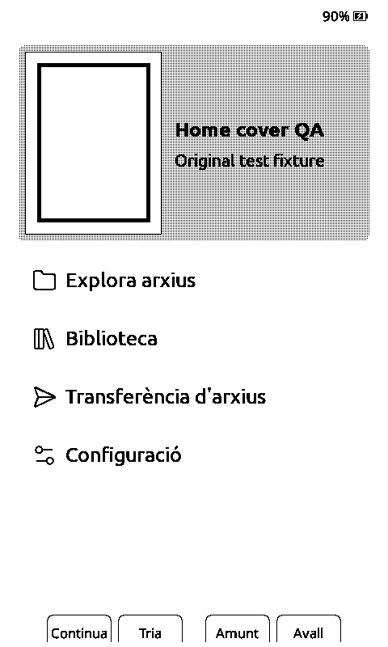

# Home cover redraw: X4 evidence

The first Home visit that generates a missing thumbnail can leave a thin black
line from the previous placeholder over the new cover. Leaving Home and returning
with the thumbnail already cached removes it. This is not limited to GIF images:
the attached EPUB contains an original geometric PNG cover, with no third-party
artwork or book text.

## Reproduce

1. Copy `home-cover.epub` to the SD card at a new path and select the Lyra theme.
2. Open the book once so its metadata is indexed, then return to Home.
3. On affected firmware, the newly generated thumbnail has an extra thin vertical
   line inside its right edge. The source cover has only the thick rectangle.
4. Leave Home and return: with the thumbnail cached, the extra line is gone.
5. With the fix, the first generated cover is already clean.

For another cold run, use a fresh copy/path, or remove only this fixture's cached
thumbnail. Do not delete the complete cache or any reading-progress files.

## Captures and checks

| Before: first generated thumbnail | After: first generated thumbnail |
| --- | --- |
|  |  |

These are framebuffer captures from a USB-connected Xteink X4, not simulator
screenshots or photographs. They do not establish optical e-paper quality or
behavior on other device models.

- The baseline is the existing Home path in integration `35a062e3`, with private
  USB diagnostics. Its Home source matches upstream `261726f61` apart from an
  unrelated activity-callback rename.
- The after image uses the standalone `default` build on upstream `261726f61`
  plus the one-line fix, without the private controller or other personal PRs.
  It was built before committing the unchanged source as `42c57531d`.
- Baseline first-generation versus clean cached Home differs by 214 stale black
  pixels at x=165, y=65..288. The standalone fixed cover band matches the clean
  cached reference exactly: zero changed pixels. The battery indicator is outside
  that comparison and naturally differs between captures.
- Eight complete cold/warm comparisons passed with zero changed pixels in the
  upper Home cover band: Lyra after returning from each of the four reader
  orientations, Classic, Lyra 3 Covers, RoundedRaff, and malformed-PNG fallback.
  Home itself is portrait; these are reader-to-Home transition checks, not a claim
  that Home was rendered in four orientations.
- The primary Lyra case also passed selection away/back. Invalid PNG input left
  the placeholder cleanly and published no completed thumbnail. These matrix
  checks used private diagnostics; they are not vanilla performance benchmarks.
- Formatting, diff checks, four independent read-only source reviews, and
  `pio run -e default` passed. Existing wolfSSL macro warnings remain. No separate
  automated unit test was added for this one-line rendering fix.
- Pinned FreeInk SDK: `25cd36c7c28192991f11ba99c1f520d19ff12fa5`.
- Standalone firmware SHA-256:
  `e5520653e5f4de5433f059db50326e36c8a062a9ab637397de07e1f69f969e06`.

Incomplete diagnostic transfers were rejected, never used as image evidence.
The device's original firmware, settings and reading position were restored.

## Scope

The fix restores the stored cover pixels only while the existing `coverRendered`
flag says they remain valid. Thumbnail generation already clears this flag.
It changes no cache format, persistent data, allocation, buffer ownership, theme,
image decoder, or device-specific code. The separate cover-grid path is unchanged.

The production PR contains only the one-line source change. This separate
evidence branch keeps the fixture and PNGs out of the firmware diff.
